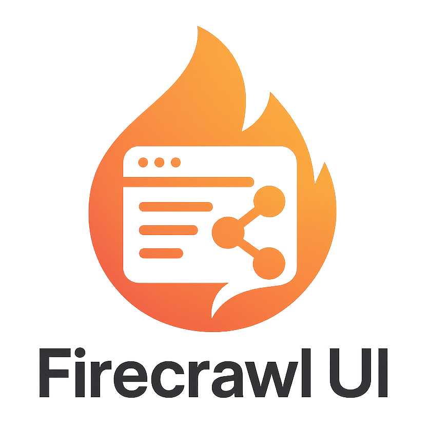
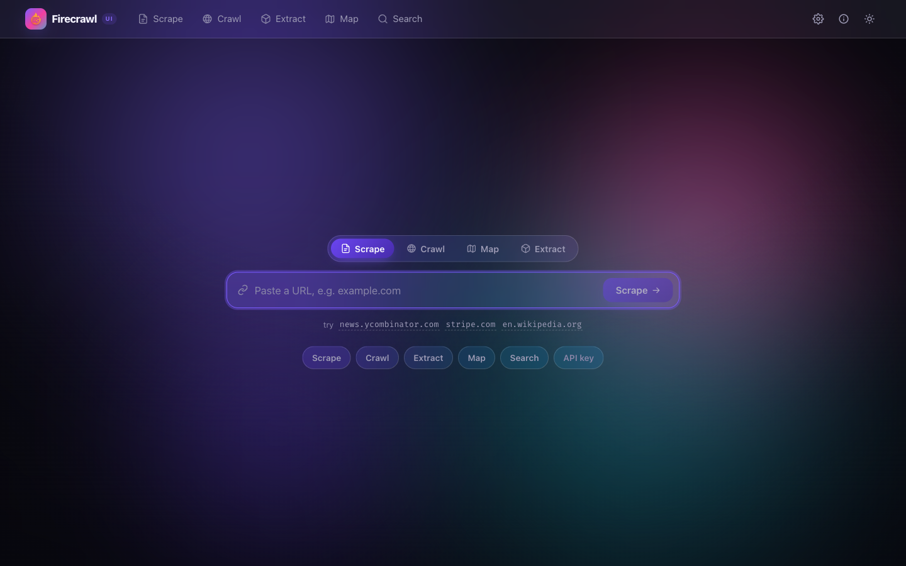
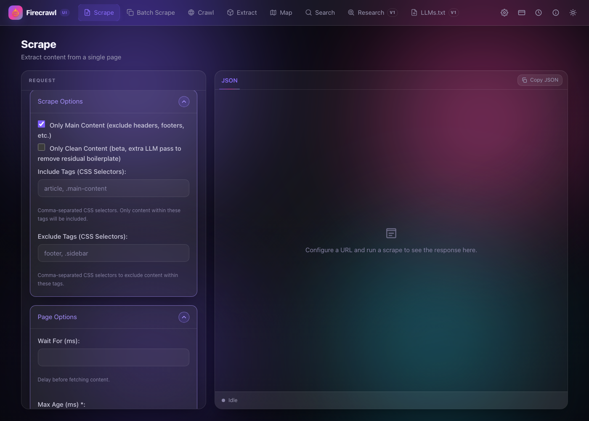
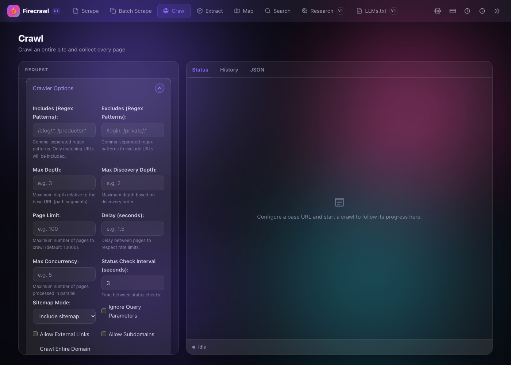
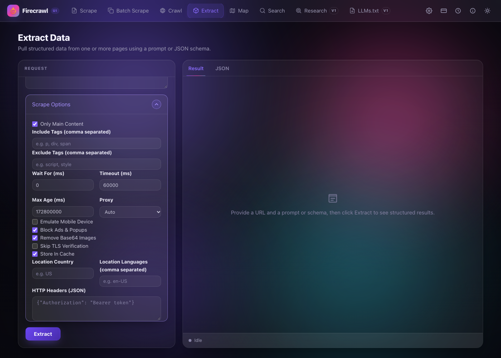
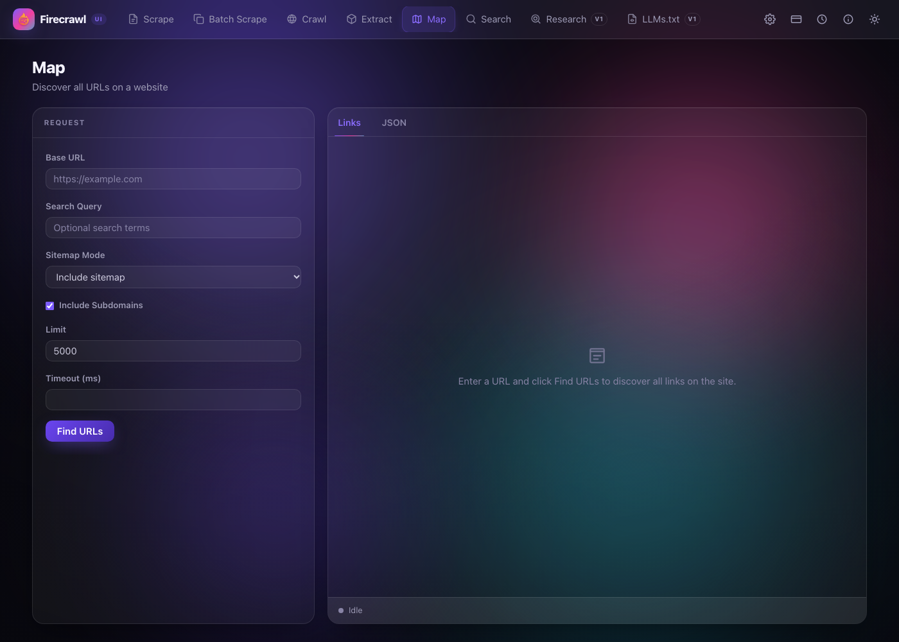
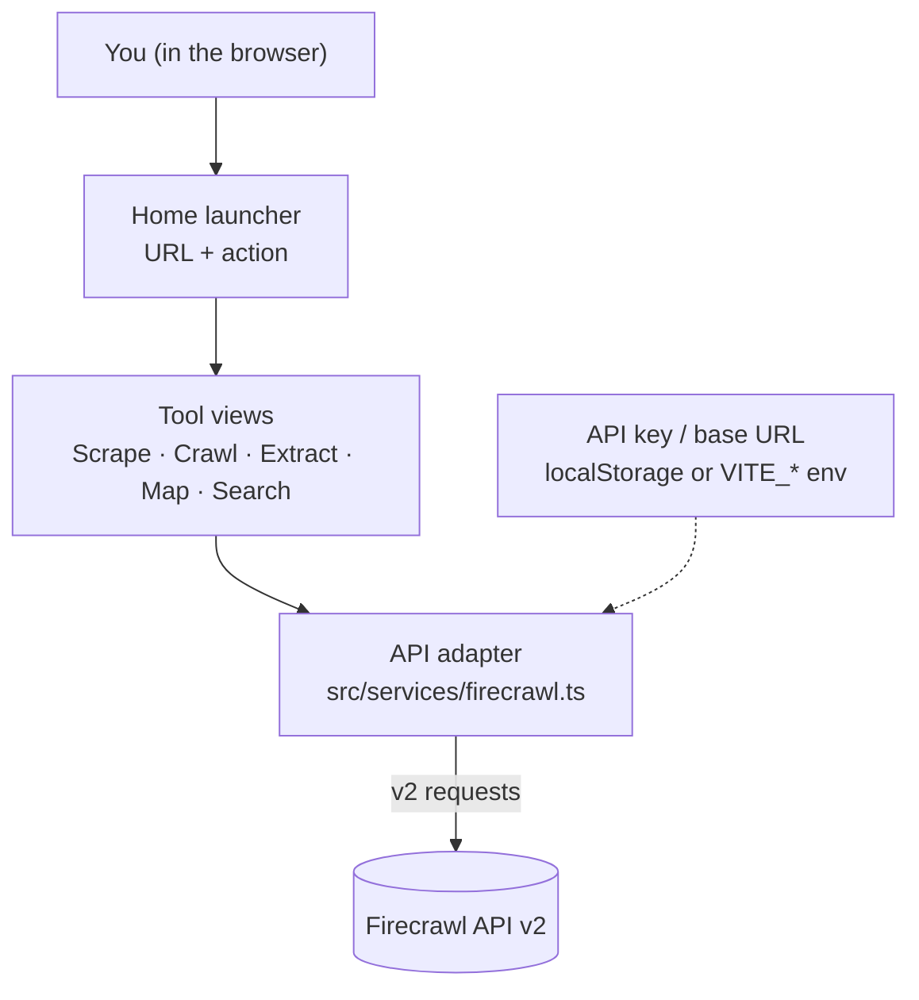

<div align="center">



# Firecrawl UI


[](LICENSE)
[](https://github.com/obeone/firecrawl-ui/actions/workflows/ci.yml)
[](https://github.com/obeone/firecrawl-ui/tags)
[](https://hub.docker.com/r/obeoneorg/firecrawl-ui)

</div>

---

Firecrawl UI is a single-page Vue 3 app that puts the
[Firecrawl API](https://firecrawl.dev/) tools behind a simple
request/response interface. You don't need to write any
integration code: open the app, drop in a URL, and read the scraped content,
crawl results, or extracted data right in the browser. Your API key and data
stay local, and you can point it at the hosted Firecrawl service or your own
self-hosted instance.

## ✨ Features

|     | Feature          | Description                                                               |
| :-: | :--------------- | :------------------------------------------------------------------------ |
| 🔗  | **URL launcher** | Paste a URL on the home, pick an action, land in the tool pre-filled      |
| 📄  | **Scrape**       | Turn a single page into clean markdown, HTML, links or structured data    |
| 📚  | **Batch scrape** | Scrape a list of URLs in one job and export the results together          |
| 🕷️  | **Crawl**        | Traverse a whole site with depth, include/exclude rules and live progress |
| 🧠  | **Extract**      | Pull structured fields from URLs with a prompt or schema (AI)             |
| 🗺️  | **Map**          | List every reachable URL of a site to understand its structure            |
| 🔍  | **Search**       | Query the web and get ranked results with optional page content           |
| 🕘  | **History**      | Reopen past jobs by ID; only metadata is kept, in your browser            |
| 🌗  | **Light / dark** | Glass + aurora theme, dark by default, remembered across sessions         |
| 🔑  | **Local config** | API key and base URL stored in your browser, never sent anywhere else     |
| 🏠  | **Self-hosting** | Point the base URL at your own Firecrawl instance (with or without a key) |

## 🚀 Demo

Try it now, no install needed: **<https://firecrawl-ui.obeone.cloud>**. Open the
settings page and add your API key (or a self-hosted base URL) to get started.



## 📦 Installation

### Local

```sh
git clone https://github.com/obeone/firecrawl-ui.git
cd firecrawl-ui
npm install
npm run dev
```

Open the URL printed in your terminal (default <http://localhost:5173/>), then
set your API key in the settings page.

### 🐳 Docker

```sh
docker run -p 8080:8080 obeoneorg/firecrawl-ui
```

Open <http://localhost:8080/>. Prebuilt images:

- `docker.io/obeoneorg/firecrawl-ui`
- `ghcr.io/obeone/firecrawl-ui`

## 🖼️ Screenshots

|              Scrape               |              Crawl              |
| :-------------------------------: | :-----------------------------: |
|  |  |

|               Extract               |             Map             |
| :---------------------------------: | :-------------------------: |
|  |  |

Each tool is a two-pane playground: build the request on the left, read the
response (preview, JSON, links and more) on the right. Option groups fold
away so long forms stay readable.

## ⚙️ Configuration

You can configure access two ways. The app shows a setup prompt on the home
until either an **API key** or a custom **API URL** (for a self-hosted
instance) is set.

**In the app:** open the settings page (gear icon) and enter your API key
and/or base URL. Values are saved to `localStorage`.

**Environment variables:** create a `.env` file in the project root. These are
read by `src/config/api.ts`.

```sh
VITE_FIRECRAWL_API_KEY=your_api_key
VITE_FIRECRAWL_API_BASE_URL=https://api.firecrawl.dev
```

| Variable                      | Description            | Default                     |
| :---------------------------- | :--------------------- | :-------------------------- |
| `VITE_FIRECRAWL_API_KEY`      | Firecrawl API key      | _(empty)_                   |
| `VITE_FIRECRAWL_API_BASE_URL` | Firecrawl service root | `https://api.firecrawl.dev` |

> [!WARNING]
> `VITE_*` variables are inlined into the JavaScript bundle at build time.
> A `VITE_FIRECRAWL_API_KEY` set when building is readable by anyone who can
> load the app, so only use it for a private deployment. For a shared or
> public deployment, leave it empty and let each user enter a key in the
> settings page, where it stays in their own browser's `localStorage`.
>
> A self-hosted instance without authentication needs no key: set only the
> base URL. The settings page has a **Test connection** button (it calls
> `GET /v2/team/queue-status`, which uses no credits) and a **Forget key**
> button that removes the key saved in the browser.

Precedence is `localStorage` > `VITE_*` env > default. Any trailing `/v1` or
`/v2` on the base URL is stripped automatically; the adapter targets **v2**.

## 🛠️ Commands

| Command             | Description                          |
| :------------------ | :----------------------------------- |
| `npm run dev`       | Start the dev server with hot reload |
| `npm run build`     | Build to `dist/`                     |
| `npm run preview`   | Preview the production build locally |
| `npm run typecheck` | Type-check with `vue-tsc`            |
| `npm run lint`      | Run ESLint                           |
| `npm test`          | Run the Vitest unit tests            |
| `npm run format`    | Format with Prettier                 |

| Docker                                 | Description                  |
| :------------------------------------- | :--------------------------- |
| `docker build -t firecrawl-ui .`       | Build the image locally      |
| `docker run -p 8080:8080 firecrawl-ui` | Serve via Nginx on port 8080 |

The image is a multi-stage build (Node 26, then `nginx-unprivileged`). A custom
`nginx.conf` rewrites unknown paths to `index.html` for client-side routing and
sends a strict Content-Security-Policy with the usual security headers
(`X-Frame-Options`, `X-Content-Type-Options`, `Referrer-Policy`,
`Permissions-Policy`). The policy is also embedded as a `<meta>` tag in the
build, so it applies behind any static host.

Published images (`ghcr.io/obeone/firecrawl-ui`, `obeoneorg/firecrawl-ui`) are
built only after CI passes and signed with cosign.

| Image tag      | Points to                        |
| :------------- | :------------------------------- |
| `latest`       | The last commit on `main`        |
| `sha-<commit>` | One exact commit                 |
| `YYYY.M.REV`   | A release, e.g. `2026.11.1`      |
| `YYYY.M`       | The latest release of that month |

Releases use CalVer `vYYYY.M.REV`, where `REV` counts the releases of the
month from 1. Pushing such a tag runs CI, which publishes the images above
and deploys the site (the site only changes on a release):

```sh
git tag v2026.11.1
git push origin v2026.11.1
```

The version is never written by hand: CI derives it from `git describe` and
shows it on the About page (`2026.11.1-3-gabc1234` for commits after a
release, `dev` for a build outside Git).

## 🔌 API

The app targets the Firecrawl **v2** API (`/v2/*`) through the hand-written
adapter in `src/services/firecrawl.ts`. See the
[Firecrawl v2 API reference](https://docs.firecrawl.dev/api-reference/v2-introduction)
for the endpoints and payloads.

### Compatibility

| Tool                                    | API    | Status          |
| :-------------------------------------- | :----- | :-------------- |
| Scrape, Batch Scrape, Crawl, Extract    | `/v2`  | Supported       |
| Map, Search, API configuration, Billing | `/v2`  | Supported       |
| **Deep Research** (`/research`)         | `/v1`¹ | Deprecated (v1) |
| **LLMs.txt** (`/llmstxt`)               | `/v1`¹ | Deprecated (v1) |

¹ Tries `/v2` first, then falls back to `/v1`.

Deep Research and LLMs.txt generation are not part of the v2 API. Firecrawl
deprecated both legacy v1 endpoints and removes them from its cloud API on
10 December 2026, 15:00 UTC. The UI keeps both tools, labelled `v1` in the top
bar and with a notice on their pages, for self-hosted installs that still serve
them. Upstream replacements: the Agent endpoint or a loop on Search for Deep
Research ([migration guide](https://docs.firecrawl.dev/migrating-from-deep-research)),
Map then Batch Scrape for LLMs.txt
([migration guide](https://docs.firecrawl.dev/migrating-from-llmstxt)).

## 🧭 Architecture



## 🤝 Contributing

Contributions are welcome. Run `npm run format:check`, `npm run lint`,
`npm run typecheck` and `npm test` before opening a pull request; CI blocks
on each of them. PR titles follow `[firecrawl-ui] <Title>`.

## 📝 License

Released under the [MIT](LICENSE) license. Powered by
[Firecrawl](https://firecrawl.dev/).

Made by **Grégoire Compagnon (obeone)**.
